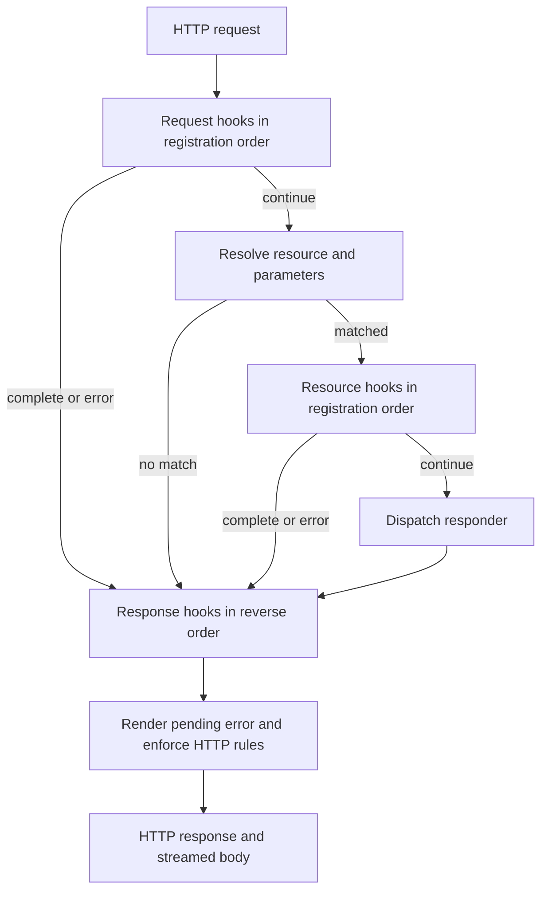

# Peregrine Web technical design

- Status: proposed v0.6; describes a target, not implemented functionality.
- Date: 2026-10-13 (Europe/Berlin).
- Audience: library implementers, API reviewers, and service maintainers.
- Scope: a resource-oriented HTTP framework with an explicit middleware engine.
- Authority: [terms of reference](terms-of-reference.md) establishes goals;
  [ADR 001](adr-001-resource-aware-lifecycle.md) records the proposed core
  choice.
- Delivery: [potential GIST roadmap](roadmap.md), including the key
  [compiler/ownership experiment](polonius-ownership-experiment.md) and
  [ADR 002](adr-002-compiler-ownership-experiment.md).

Extension-interface stabilization is governed by
[ADR 006](adr-006-extension-interface-stabilization.md): separate delivery of
`peregrine-correlate` and Pachislot, an independent WebSocket adapter, and
removal, substitution, composition, and failure-symmetry evidence are
mandatory. Roadmap tasks 7.3.4 and 7.4.1–7.4.3 deliver and evaluate these
consumers.

## 1. Problem, evidence, and design boundaries

Peregrine keeps endpoint operations, dependencies, and policy on resource
objects. Routing exposes the selected object to middleware before dispatch. A
mutable context carries request state and the developing response through a
framework-owned lifecycle. This preserves the central requirements of the
project brief and the accompanying architectural paper.[^1]

The repository currently contains a library stub and no runtime dependencies.
Every interface below is a proposed contract. The compiler experiment records
measured acceptance of isolated examples; no framework benchmark, deployment
compatibility claim, or runnable framework example is implied.

The project owner selected a Peregrine reimplementation of Mornington as the
pilot.
[ToR §9.1](terms-of-reference.md#91-mornington-pilot-and-comparative-review)
records the pinned Actix-based design comparator, protected thread/reply
operations, and bounded JSON long polling. Mornington has no implemented forum
to migrate yet; its proposed workload does not establish Peregrine performance.
Its application services retain authentication, delegated authorization, and
durable effects. The owner holds the authority, reviewer, and operator roles;
the owner accepted the pilot's HTTP/1.1/Traefik boundary on 2026-10-13. No SSE
or WebSocket upgrade is required by this pilot, and it does not replace ADR
006's independent extension consumers.

The initial delivery target is a single `peregrine-web` library, in-process
request execution, and an HTTP/1.1 serving adapter. Buffered convenience and
streaming belong in the core release. Pachislot is now a named WebSocket
extension consumer: §9.1 proposes an optional owned HTTP/1.1 upgrade boundary,
with delivery gated separately from the initial core. HTTP/2, native Transport
Layer Security (TLS), hot route reload, and a supported Tower adapter remain
deferred under the accepted pilot scope in terms of reference §9.1. A
deployment can supply secure ingress externally; trusted forwarding
configuration remains explicit.

### 1.1. Reconciliation of the source papers

| Source detail                                                                    | Proposed interpretation or correction                                                                               |
| -------------------------------------------------------------------------------- | ------------------------------------------------------------------------------------------------------------------- |
| `Resource`, `FalconResource`, and `PeregrineMiddleware` names                    | Use `Resource` and `Middleware`; Falcon names describe inspiration, not compatibility.                              |
| Resource marker-trait inspection                                                 | Expose a typed policy method on `Resource`; do not assume a trait object can discover unrelated implemented traits. |
| Unsupported responders return either success with status 405 or a semantic error | Use a semantic failure, with explicit method metadata supplying `Allow`.                                            |
| Parameter examples use `/users/:id`                                              | Use `/users/{id}` for the selected current `matchit` syntax.                                                        |
| Copying parameters is labelled zero-copy                                         | Owned parameter strings allocate; retain the simple ownership boundary until measurement justifies a change.        |
| `Request<Incoming>` is described as optional and replayable                      | Separate request metadata from an explicit single-consumer body state.                                              |
| Response ordering is configurable or reverse by default                          | Propose one reverse-order policy for the initial release.                                                           |
| Dispatch cost is described as negligible                                         | Treat its magnitude as an untested hypothesis; benchmark allocation and tail latency.                               |

_Table 1: Source reconciliation; new choices remain proposed._

### 1.2. Ecosystem constraints

Falcon documents independent response middleware and post-routing resource
hooks; these inform the design without promising identical behaviour.[^2]
Hyper's server guide supplies the service/connection boundary and Tokio I/O
adaptation.[^3] `matchit` supplies path matching, parameter extraction, and
registration conflict detection.[^4]

Rust's dyn-compatibility rules constrain async resource objects. The
`async-trait` transformation supplies boxed `Send` futures; sharing resources
requires `Send + Sync`, while moving request futures between threads requires
`Send`. Request-local state need not be shared concurrently.[^5] These are
separate obligations, not a claim that all async state must be `Sync`.

Tower composition remains an alternative, but it does not by itself define
Peregrine's resource visibility or phase semantics. The choice to own those
semantics is recorded in ADR 001. No claim that another framework is incapable
of resource-aware policy is necessary to justify this experiment.

## 2. Architecture and ownership

The application builder accepts resource registrations, an ordered middleware
list, and explicit configuration. `build` validates routes and configuration,
then freezes them into application state shared through `Arc`. Requests cannot
mutate this registry. Resources own their application dependencies; the
framework does not provide a dependency-injection container.

A resource is an inbound HTTP adapter, not a domain entity. The application
composition root constructs it with narrow service dependencies: a concrete
service or an application-owned dyn-compatible port. Resource erasure at the
router boundary does not require service erasure. Required dependencies are
constructor inputs; missing services never trigger implicit fixture selection
or request-time lookup. Shared dependency bundles remain an application choice.
Application ports need no Peregrine, HTTP, or serialization types. Application
roots may import concrete adapters; ordinary inbound adapters depend on
application contracts rather than outbound implementations. See the
[hexagonal case study](hexagonal-application-case-study.md) and proposed
[ADR 004](adr-004-application-port-boundaries.md).

The pipeline borrows resources and middleware from immutable application state.
The baseline owns one context, passed sequentially as `&mut Context`. The
experiment in §3.1 instead loans narrower phase views from the same request
owner. Neither model requires a global context lock. Resource implementations
remain responsible for synchronizing their own shared mutable state and
avoiding blocking work on runtime threads.

The diagram shows normal progression and the exits into response processing.



_Figure 1: The pipeline owns phase transitions; all ordinary exits reach
response processing before finalization._

A streamed body is transferred only after finalization. Response hooks can
replace or wrap that body before transfer; they do not execute again when the
stream ends. Transport completion is a separate observability event.

| Component                  | Owned state and permitted responsibility                                        | Reuse boundary                                                      |
| -------------------------- | ------------------------------------------------------------------------------- | ------------------------------------------------------------------- |
| Application builder        | Route registration, middleware ordering, validated configuration.               | Startup only; not a request-time registry.                          |
| Router                     | Resource values and registered templates.                                       | Resolution only; never authorize or render responses.               |
| Pipeline                   | Phase state, matched resource reference, and failure progression.               | One engine for in-process and transport entrypoints.                |
| Context                    | Request metadata, body state, parameters, typed extensions, and response draft. | One request; no application-global storage.                         |
| Resource                   | Endpoint operations, method declaration, and typed policy.                      | Shared object; application dependency ownership stays here.         |
| Middleware                 | Cross-resource lifecycle behaviour.                                             | Hooks inspect context and resource contracts; no hidden rerouting.  |
| Body and response boundary | Bounded collection, stream ownership, error rendering, and HTTP finalization.   | Used by context operations and pipeline finalization.               |
| Server adapter             | Listener, admission, connection tasks, cancellation, and drain.                 | Invokes the same application operation; does not duplicate routing. |

_Table 2: Proposed component ownership and composition rules._

These are logical responsibilities, not a requirement for one module per row. A
repository sweep found no equivalent implementation beyond `src/lib.rs`'s stub.
Implementation should group modules by feature under the existing
[repository layout](repository-layout.md), keep files within repository limits,
and repeat the equivalence check before adding helpers. Extract another crate
only when an independently useful boundary has been demonstrated.

The [actix-v2a case study](actix-v2a-middleware-case-study.md) tests these
boundaries against existing extensions and proposed mutation contracts.
[ADR 003](adr-003-http-integration-boundaries.md) records the resulting HTTP
integration refinements: typed helpers for inputs, engine-owned presentation,
and application-owned durable effects. Its examples are proposed contracts, not
evidence that the runtime already exists.

## 3. Application and context contracts

`PeregrineApp::handle` accepts an HTTP request whose body can be adapted to the
framework body interface. It asynchronously returns an HTTP response using the
same pipeline as the server. Recoverable application failures become responses;
body failures after commitment remain body-stream errors. The Hyper service can
therefore use `Infallible` as its service error without claiming that network
I/O or body transfer is infallible.

The input boundary must accept synthetic bodies for tests as well as Hyper's
`Incoming`. Type erasure happens once at that boundary. Bodies carry byte
frames and trailers, are `Send`, and do not require `Sync` solely for
concurrent request serving. A boxed body implementation meeting those bounds is
selected and compile-tested in the first spike; the conceptual `BoxBody` in the
source papers is not a complete type signature.

Context exposes request metadata for inspection, route parameters for reading,
mutable response operations, and typed extensions. Framework-owned lifecycle,
route selection, and error state stay private. `complete()` makes forward
completion monotonic; public code cannot clear it. Returning an error after
calling `complete()` still records a failure and overrides the success draft.

Pre-routing middleware may rewrite the effective URI through an explicit
operation. Preserve the original URI for diagnostics. Freeze the effective
method and route target before resource policy runs; resource and response
hooks cannot change the dispatch destination. In the baseline, parameters are
copied into owned strings before borrowing the context mutably again. This
avoids borrowing the URI inside the context across later mutations.

Request metadata survives body consumption. Typed extensions store application
state such as authenticated identity; absent identity is a normal condition
that policy must handle. No environment reads occur inside the pipeline.
Applications resolve configuration at startup and inject it.

### 3.1. Experimental compiler and ownership direction

**Key GIST idea:** a pure Polonius-plus-new-solver implementation may make
borrowing helpers and resource-aware middleware easier to express without
sacrificing entity-first ergonomics. [Roadmap phase 2](roadmap.md) tests this
before later slices commit to a public ownership model. The detailed
[experiment specification](polonius-ownership-experiment.md) contains paired
code examples, measured compiler results, attribution controls, and acceptance
criteria. [ADR 002](adr-002-compiler-ownership-experiment.md) records the
proposed compiler posture; adoption remains undecided.

The exclusive candidate targets a pinned compiler with
`-Zpolonius=next -Znext-solver=globally`. It carries no old-checker
compatibility implementation. It can still own data, share resources through
`Arc`, and erase types at heterogeneous boundaries. The comparator uses the
same compiler with both mechanisms disabled explicitly; that comparator alone
does not establish support for a stable compiler release.

Both candidates may use phase-specific views: immutable request metadata and
frozen routing information, separate mutable body and response capabilities,
and explicit `Continue`/`Respond` hook outcomes. The engine owns transitions,
failures, and response unwinding. Resource methods and policy stay on the
resource object; a typed endpoint adapter retains that object before erasing
its invocation boundary for router storage. Request-local borrows may survive
an awaited hook but cannot escape into response streams or detached tasks
without suitable ownership.

Initial four-way probes demonstrate a Polonius-specific benefit for returning
cached borrows before fallible miss initialization. They demonstrate no
solver-specific benefit. Split-field async responders work in all four
configurations; native async dyn dispatch and overlapping mutable borrows fail
in all four. Thus compiler exclusivity is a falsifiable idea, not a
prerequisite for Rust-like ownership or an allocation-free dispatch promise.

The experiment must compare the best compatible APIs, preserve the lifecycle in
§§5–10, and measure runtime, compile-time, and consumer-tooling costs
separately. Select one maintained direction through roadmap task 2.2.3. If only
ownership partitioning improves ergonomics, retain that design without claiming
Polonius or solver necessity. The following sections specify the invariant
contracts and baseline API shapes; the experiment may refine the latter but
must not silently weaken the former.

### 3.2. Typed inputs and immutable request facts

Prefer synchronous typed parsers on borrowed metadata over middleware that
populates a hidden bag of required inputs. Required and optional header parsing
are distinct operations; both retain all occurrences until duplicate checks
finish. Empty-value semantics belong to each parser: an empty SSE replay cursor
can mean absent, while an empty UUID idempotency key is invalid. Metadata
parsing never consumes a body. Domain validation and normalized-intent hashing
remain explicit resource/application operations.

Resources may call these helpers directly. An optional typed responder adapter
may prepare inputs and convert returned values into a response draft at the
existing dispatch boundary, after resource policy. It introduces no extra
lifecycle phase, parser registry, or implicit extraction order. The ownership
prototype must validate its lifetime, `Send`, and error-conversion contracts.
Actix already supports typed extractors; this refinement prevents Peregrine's
context model from losing that clarity.

Initialize read-only `RequestFacts` before request hooks with correlation and
an injected start time. An application-configured correlation policy validates
or generates the identifier from header occurrences and trusted transport peer
facts. Header name, generator, optional validator, trust rules, and response
echo are explicit configuration. A falcon-correlate-compatible profile replaces
untrusted/invalid IDs; a stricter rejection profile still assigns a locally
generated identifier and a pending failure, then skips forward hooks. Freeze
optional route facts after routing. Keep authentication separate. Hooks and
rendering receive restricted views; arbitrary extension mutation cannot replace
the engine's correlation value. Retain the small facts needed by the timeout
supervisor without extending request-local body borrows. Pre-context
parser/connection errors and panics have no correlation guarantee.

Correlation is a bounded opaque value, not authentication or a mandatory UUID
format. Generator output must also be safe and bounded. Finalization applies
the configured echo policy; cleanup and cancellation do not rely on a response
hook restoring ambient state. Optional logging, HTTP-client, and job adapters
propagate owned snapshots and preserve carrier-specific override rules. An
upgraded connection receives its own immutable facts; message correlation is
separate from handshake correlation. See the
[extension design](pachislot-extension-design.md) §3 and
[ADR 005](adr-005-extension-and-upgrade-boundaries.md).

## 4. Resources, method metadata, and policy

In the baseline, `Resource` is a dyn-compatible, `Send + Sync` contract. It
supplies responders for GET, POST, PUT, DELETE, PATCH, HEAD, and OPTIONS.
Responders receive `&self` and `&mut Context` and return a semantic result.
Initial async dispatch uses `async-trait`; there is no custom routing macro or
assumed future language feature. Section 3.1 also evaluates generic resource
authoring with a separate erased invocation adapter, without assuming native
async dyn compatibility. Default responders return `MethodNotAllowed`.

A synchronous `supported_methods()` declaration belongs to the resource.
Registration captures it once and rejects duplicate or unsupported method
entries. The declaration controls dispatch and the `Allow` header. Rust does
not provide reflection over overridden default methods, so implementation tests
must exercise every declared method. Calling a default responder for a declared
method is a resource contract violation, rendered as an internal failure and
reported diagnostically. An undeclared override is unreachable.

This explicit declaration is a known duplication risk within the resource; it
is preferable initially to a second route-policy registry or compulsory code
generation. A later helper may remove repetition only if it preserves visible
registration and diagnostics.

For policy, propose a required synchronous `policy()` method returning typed
metadata with explicit `Public`, `Authenticated`, or `Scopes` authorization.
Scope names use a domain wrapper; an empty required-scope set is a registration
error. Policy is immutable after build, while tenant or object-level checks can
also inspect route parameters and authenticated identity. Method-sensitive
policy receives the frozen method, rather than inferring it from a route name.

A configured authorization middleware enforces protected policy. Building an
application with protected resources but without an enforcement component
fails. Identity extraction is supplied by the application; the core owns
neither token formats nor an identity provider. Missing identity produces 401
with a configured challenge; insufficient permission produces 403.
Authorization is evaluated in the resource phase before any responder,
including automatic HEAD or OPTIONS.

An illustrative contract scenario is `GET /users/42`: routing selects the
`UserResource`, records `user_id = "42"`, and passes that same object to policy
middleware. A missing read scope produces 403 and zero responder calls. A valid
identity allows the responder to query its injected repository and populate a
JSON response. Policy rejection still reaches response hooks.

The policy vocabulary and enforcement registration API require the Q3 spike
before acceptance. Rate-limit and audit classifications are extension
candidates; they do not imply built-in policy engines.

### 4.1. Illustration: protected mutation with explicit inputs

The case study's material benefit is the common policy checkpoint around an
ordinary service call. A billing resource owns its invoice service and declares
method-sensitive write policy. The engine authorizes that actual resource
before parsing operation inputs or dispatching a mutation. Actix can express
the same pattern with resource data and registration helpers; Peregrine makes
this order part of its contract.

This proposed typed-adapter example keeps the key and normalized intent
visible. The names are illustrative; no such framework API is implemented yet.

```rust,no_run
async fn on_post(&self, input: RequestView<'_>, body: &mut BodySlot)
    -> Result<InvoiceReply, Failure>
{
    let key = input.required_header::<IdempotencyKeyHeader>()?;
    let intent = CreateInvoice::validate_and_normalize(body.json().await?)?;
    Ok(self.invoices.create(input.principal()?, key, intent).await?)
}
```

`IdempotencyKeyHeader` denotes an application parser adapter returning a typed
key, not an existing framework type. The application service owns scoped
identity, fingerprint versions, claim and completion, durable transaction
boundaries, and replay redaction. It remains callable without HTTP. An HTTP
replay traverses resource authorization again; the service additionally checks
current object-level access. The framework must not infer an operation's
durable result from its eventual response status. Reserving in a resource hook
and completing in a response hook is not the supported general mutation
contract: cancellation can skip completion, and a later hook can fail after the
domain effect committed. Lease expiry alone never establishes safe effect
retry. See the [case study](actix-v2a-middleware-case-study.md) for the full
counterexample and actix-v2a's proposed adapter boundaries.

### 4.2. Resource-local services and application context

Corbusier's HTTP adapter forwards through application façades; Wildside injects
command/query ports through a broad HTTP state bundle. A resource can instead
own only its task or annotation service. This may reduce forwarding and the
number of files changed when adding a dependency; it is hypothesis H1, not a
measured improvement. The following schematic body illustrates the intended
boundary, with application-defined types and helper functions:

```rust
// Inside a TasksResource responder, after resource-policy admission:
let context = application_context(verified_identity, input.facts())?;
let payload = decode_create_task(body).await?;
let command = TaskCommand::try_from(payload)?;
let task = self.tasks.create(&context, command).await.map_err(map_task_error)?;
response.set_json(TaskReply::from(task))?;
```

The resource may contain `Arc<ConcreteTaskService>` or `Arc<dyn TaskCommands>`.
The latter requires a dyn-compatible application port with explicit async
future erasure; both must satisfy the resource's concurrency bounds. The
compiler experiment must retain the same application boundary in both variants.
A generic resource does not require a framework-defined application-service
trait, resource base-class hierarchy, or universal workflow helper.

Verified identity is distinct from request facts. The HTTP adapter explicitly
constructs the application's own context; correlation and untrusted tenant
headers grant no authority. The service preserves tenant and object-level
checks when invoked by another adapter. Domain commands and outcomes remain
independent of HTTP; the adapter owns request decoding, response projection,
and error mapping. A non-HTTP caller supplies its own validated context.

An application service or use-case wrapper owns per-operation units of work.
Shared resources hold a service or factory, not a mutable transaction shared
across requests. This is a proposed boundary improvement for adapter-owned
unit-of-work helpers such as Episodic's, not a claim about existing migrations.
Response hooks do not decide commit or rollback, and cancellation does not
prove that no effect occurred. Case study E1 and E2 compare these choices using
one bounded specimen before production API stabilization.

## 5. Routing and HTTP method semantics

Use `matchit` behind registration and lookup boundaries. The proposed route
syntax is `/users/{user_id}` and a terminal `/{*rest}` catch-all. Current
upstream syntax gives static segments priority over dynamic matches.[^4]
Invalid, ambiguous, or duplicate registrations fail before serving, with the
template included in a semantic build error.

Match the effective URI path without its query. Do not silently normalize
trailing slashes, collapse path segments, or percent-decode before matching.
Parameters retain their encoded representation; a separate explicit decoder
rejects malformed escapes and invalid UTF-8. Authorization and the responder
must use the same decoding operation and reject ambiguous identifiers. A
parameter is never implicitly a filesystem path.

The following proposed dispatch contract applies after successful resource
policy processing. Earlier middleware may reject the request first.

| Condition                                                               | Result                                                                                           |
| ----------------------------------------------------------------------- | ------------------------------------------------------------------------------------------------ |
| No matching resource                                                    | 404; no resource hooks or responder.                                                             |
| Recognized method absent from a matched resource's effective method set | 405 with `Allow` derived from that set.                                                          |
| Declared method                                                         | Invoke its responder once.                                                                       |
| HEAD with GET declared and no explicit HEAD responder                   | Invoke GET with the original method retained as HEAD; suppress response content at finalization. |
| OPTIONS without an explicit responder                                   | Return 204 and the resource's effective `Allow` set.                                             |
| TRACE or CONNECT on a matched resource                                  | 405; these recognized methods are disabled in the initial service.                               |
| Unknown extension method on a matched resource                          | 501; no arbitrary method-dispatch fallback.                                                      |

_Table 3: Routing and method outcomes for the proposed initial release._

For ordinary HTTP resources, the effective method set adds HEAD when GET is
supported and always includes OPTIONS. `OPTIONS *` is a server-level capability
request: after request hooks, return 204 with the server's implemented method
set, then response hooks; there is no routed resource. HEAD suppression applies
to errors and short circuits, not only successful GET fallbacks.

HTTP rules take precedence over response mutations. A 405 requires `Allow`;
HEAD, 204, 205, and 304 responses carry no content. Remove prohibited framing
fields, including `Content-Length` on 204. Preserve a HEAD or 304 length only
when it correctly describes the corresponding representation. Do not consume a
stream to calculate that length. Reject informational status codes as final
application responses.[^6] The optional upgrade endpoint in §9.1 is a separate,
validated final outcome; it never treats an arbitrary response status of 101 as
permission to transfer a connection.

### 5.1. Final content and framing matrix

These constraints apply after failure selection to every L row and supervised
C07 response. The original request method controls HEAD, even on GET fallback.
The rules follow RFC 9110 §§8.6, 9.3.2, 15, and 15.3.6, inspected on 2026-10-13.

| ID  | Final condition                                               | Body                                       | Content-Length                                                  | Other representation/framing constraints                                                         |
| --- | ------------------------------------------------------------- | ------------------------------------------ | --------------------------------------------------------------- | ------------------------------------------------------------------------------------------------ |
| H01 | Original method HEAD                                          | Empty, including errors and short circuits | Retain only a verified corresponding GET length; otherwise omit | Do not poll/collect a stream for length; remove Transfer-Encoding                                |
| H02 | Status 204                                                    | Empty                                      | Remove                                                          | Remove Transfer-Encoding; retain selected required Allow if applicable                           |
| H03 | Status 205                                                    | Empty                                      | Set 0                                                           | Remove Transfer-Encoding; RFC 9110 prohibits content, rather than prohibiting zero length        |
| H04 | Status 304                                                    | Empty                                      | Retain only verified corresponding 200 length; otherwise omit   | Do not poll a stream; remove Transfer-Encoding                                                   |
| H05 | Other final status in 200..599                                | Selected body                              | Derive from known byte representation or omit for stream        | Transport owns wire framing; failure replacement clears stale metadata                           |
| H06 | Arbitrary final 1xx including 101, or status outside 100..599 | Replace with sanitized 500 under L36       | Derive for safe replacement                                     | No upgrade or second hook pass; the separate experimental upgrade contract is outside this pilot |

_Table 3a: Finalizer content constraints. For HEAD combined with 204/205, the
status-specific length rule wins; for HEAD/304 require the applicable verified
representation length._

## 6. Middleware lifecycle and completion

The baseline middleware contract has three hooks: `process_request(ctx)`,
`process_resource(ctx, resource)`, and `process_response(ctx)`. Each takes a
shared middleware reference and returns a semantic result. Default hooks
succeed without changing state. Response hooks inspect route information
through the context, which may have no match.

The pipeline applies these rules:

1. Create context and request facts. Unless initialization already failed,
   run request hooks in registration order.
2. On completion or failure, stop forward processing and enter the response
   phase. Otherwise resolve the route and establish immutable parameters.
3. On a route match, run resource hooks in registration order with the selected
   resource. Recheck completion or failure after each hook.
4. If forward processing remains active, dispatch one responder.
5. Run every registered response hook once, in reverse registration order,
   irrespective of how many request or resource hooks ran.
6. Render the final selected failure, apply the configured engine-owned
   correlation policy and required headers, enforce HTTP invariants, and
   finalize once.

For middleware A, B, C, a short circuit in B's request hook gives
`A.request, B.request, C.response, B.response, A.response`. A normal request
also includes `C.request`, all three resource hooks, and the responder before
that response sequence. Hooks must tolerate missing setup in typed extensions.
There is no second configurable unwind policy in the initial release.
Response-hook status is provisional: another hook can still fail. Hooks do not
own durable mutation completion or final-status instrumentation. Read-only
request facts are available even when a hook's optional setup is absent.

These guarantees cover futures driven to completion with ordinary `Result`
failures. Dropping a future, runtime shutdown, or a panic can prevent later
hooks from running. Cleanup that must occur on cancellation belongs in
ownership and `Drop`, without asynchronous work. Hooks must not be presented as
guaranteed audit delivery or transaction rollback.

### 6.1. Ordinary-exit contract

The following rows specify the initial core. They do not claim implemented
behaviour. `R` means every registered response hook, exactly once in reverse
order (C, B, A for registration A, B, C); with zero hooks it is empty. `G`
means bounded private diagnostics and ownership-based synchronous release, with
no promised durable effect, asynchronous cleanup, or rollback. Each row enters
response processing with commitment false; after R and finalization it commits
once if the peer can receive a response. Failure selection follows §7.2, so a
later response-hook failure can replace every ordinary status below with 500.
`D` counts responder invocations, including a responder that returns an error.
Body errors before dispatch and inside a responder are separate rows. Resource
identity, parameters, and effective responder method freeze at routing; the
original method remains available for HEAD suppression.

| ID  | Exit and entry phase                                                                   | Resource available                          | Remaining forward work                   | D                  | Response hooks                       | Selected outcome before later hook failures     | Commitment and guarantees                                       |
| --- | -------------------------------------------------------------------------------------- | ------------------------------------------- | ---------------------------------------- | ------------------ | ------------------------------------ | ----------------------------------------------- | --------------------------------------------------------------- |
| L01 | Request-fact initialization or trusted correlation input rejected                      | No                                          | None                                     | 0                  | R                                    | 400                                             | Finalize then commit; G; no valid ID promised                   |
| L02 | Correlation generator fails or generates invalid output at initialization              | No                                          | None                                     | 0                  | R                                    | 503                                             | Finalize then commit; G; omit ID everywhere                     |
| L03 | Request hook completes                                                                 | No                                          | None                                     | 0                  | R                                    | Completed draft                                 | Finalize then commit; G                                         |
| L04 | Request hook returns failure                                                           | No                                          | None                                     | 0                  | R                                    | First typed failure                             | Finalize then commit; G                                         |
| L05 | Route lookup misses                                                                    | No                                          | None                                     | 0                  | R                                    | 404                                             | Finalize then commit; G                                         |
| L06 | Resource hook completes                                                                | Frozen                                      | None                                     | 0                  | R                                    | Completed draft                                 | Finalize then commit; G                                         |
| L07 | Resource policy or resource hook rejects                                               | Frozen                                      | None                                     | 0                  | R                                    | Typed denial, normally 401/403                  | Finalize then commit; G                                         |
| L08 | Responder succeeds                                                                     | Frozen                                      | None                                     | 1                  | R                                    | Responder draft                                 | Finalize then commit; G                                         |
| L09 | Responder returns failure                                                              | Frozen                                      | None                                     | 1                  | R                                    | First typed failure                             | Finalize then commit; G; effect may already exist               |
| L10 | Recognized unsupported method, including disabled TRACE/CONNECT, after resource policy | Frozen                                      | None                                     | 0                  | R                                    | 405 with effective Allow                        | Finalize then commit; G                                         |
| L11 | Unknown extension method after resource policy                                         | Frozen                                      | None                                     | 0                  | R                                    | 501                                             | Finalize then commit; G                                         |
| L12 | Automatic resource OPTIONS after resource policy                                       | Frozen                                      | None                                     | 0                  | R                                    | 204 with effective Allow                        | Finalize then commit; G                                         |
| L13 | Explicit resource OPTIONS after resource policy                                        | Frozen                                      | Invoke declared responder then R         | 1                  | R                                    | Responder result or typed failure               | Finalize then commit; G                                         |
| L14 | OPTIONS * after request hooks                                                          | No                                          | None; no routing/resource hooks          | 0                  | R                                    | 204 with server implemented-method Allow        | Finalize then commit; G                                         |
| L15 | Explicit HEAD after resource policy                                                    | Frozen                                      | Invoke HEAD then R                       | 1                  | R                                    | Responder result; no content                    | Finalize then commit; G                                         |
| L16 | HEAD falls back to GET after resource policy                                           | Frozen                                      | Invoke GET once, retaining original HEAD | 1                  | R                                    | GET result; no content                          | Finalize then commit; G                                         |
| L17 | HEAD completes or fails before routing/dispatch                                        | No or frozen according to stopping phase    | None                                     | 0                  | R                                    | Completed draft or selected failure; no content | Finalize then commit; G                                         |
| L18 | Body byte cap exceeded before dispatch                                                 | No in request hook; frozen in resource hook | None                                     | 0                  | R                                    | 413                                             | Finalize then commit; G; consumption failed                     |
| L19 | Body byte cap exceeded inside responder                                                | Frozen                                      | None                                     | 1                  | R                                    | 413                                             | Finalize then commit; G; consumption failed                     |
| L20 | Unsupported media before dispatch                                                      | No in request hook; frozen in resource hook | None                                     | 0                  | R                                    | 415                                             | Finalize then commit; G                                         |
| L21 | Unsupported media inside responder                                                     | Frozen                                      | None                                     | 1                  | R                                    | 415                                             | Finalize then commit; G                                         |
| L22 | Malformed JSON before dispatch                                                         | No in request hook; frozen in resource hook | None                                     | 0                  | R                                    | 400                                             | Finalize then commit; G                                         |
| L23 | Malformed JSON inside responder                                                        | Frozen                                      | None                                     | 1                  | R                                    | 400                                             | Finalize then commit; G                                         |
| L24 | Buffered read deadline before dispatch                                                 | No in request hook; frozen in resource hook | None                                     | 0                  | R                                    | 408                                             | Finalize then commit; G; consumption failed                     |
| L25 | Buffered read deadline inside responder                                                | Frozen                                      | None                                     | 1                  | R                                    | 408                                             | Finalize then commit; G; consumption failed                     |
| L26 | Recoverable request-body transport error before dispatch                               | No in request hook; frozen in resource hook | None                                     | 0                  | R                                    | 400                                             | Finalize then commit; G; failed consumption                     |
| L27 | Recoverable request-body transport error inside responder                              | Frozen                                      | None                                     | 1                  | R                                    | 400                                             | Finalize then commit; G; failed consumption                     |
| L28 | Invalid/repeated ownership transfer before dispatch                                    | No or frozen according to phase             | None                                     | 0                  | R                                    | 500 semantic body-state failure                 | Finalize then commit; G                                         |
| L29 | Invalid/repeated ownership transfer inside responder                                   | Frozen                                      | None                                     | 1                  | R                                    | 500 semantic body-state failure                 | Finalize then commit; G                                         |
| L30 | Request stream idle expiry before dispatch                                             | No or frozen according to phase             | None                                     | 0                  | R                                    | 408                                             | Finalize then commit; G; failed stream                          |
| L31 | Request stream idle expiry inside responder before commitment                          | Frozen                                      | None                                     | 1                  | R                                    | 408                                             | Finalize then commit; G; failed stream                          |
| L32 | Request stream total-byte exhaustion before dispatch                                   | No or frozen according to phase             | None                                     | 0                  | R                                    | 413                                             | Finalize then commit; G; failed stream                          |
| L33 | Request stream total-byte exhaustion inside responder before commitment                | Frozen                                      | None                                     | 1                  | R                                    | 413                                             | Finalize then commit; G; failed stream                          |
| L34 | First or later reverse response hook fails                                             | Frozen if routing occurred; otherwise no    | None                                     | Prior D, unchanged | Continue remaining R, without replay | First such failure selects sanitized 500        | Finalize then commit; G; later failures invalidate presentation |
| L35 | Renderer fails or encoded output exceeds cap, after R                                  | Frozen if routing occurred; otherwise no    | None                                     | Prior D, unchanged | R already finished; no replay        | Static sanitized 500                            | Finalize then commit; G; no custom renderer retry               |
| L36 | Informational 1xx or invalid-range status reaches final validation                     | Frozen if routing occurred; otherwise no    | None                                     | Prior D, unchanged | R already finished; no replay        | Sanitized 500                                   | Finalize then commit; G; arbitrary 101 cannot upgrade           |
| L37 | Rejection leaves unread body and framing permits response                              | No or frozen according to rejection phase   | None                                     | Prior D, unchanged | R                                    | Selected rejection                              | Send safe response then close; never unbounded drain; G         |
| L38 | Nonempty owned response stream lacks CFG03 capacity after R, before finalization       | Frozen if routing occurred; otherwise no    | None                                     | Prior D, unchanged | R already finished; no replay        | Static 503 capacity rejection                   | Drop unhanded stream; finalize then commit; G                   |

_Table 4a: Exhaustive ordinary-exit families; phase-dependent variants state
the resource and dispatch distinctions explicitly._

Each ordinary row is crossed with §5.1's final content rules, including HEAD
and 204/205/304. A transport/parser rejection before context creation is not an
ordinary engine exit and cannot promise R. Body frames received by a response
stream after commitment use C09–C11 rather than L30–L33.

### 6.2. Interruption and transfer contract

An interruption is not a returned `Result`. The completed trace prefix can be
relied upon; hook-start and interruption events may also have been recorded. A
currently awaited hook is not treated as completed. Drop releases owned
resources synchronously. A separate tracked supervisor can observe a
cancellation category but cannot reconstruct unexecuted hooks or prove that an
application effect did not occur. The count below is the count at interruption,
not permission to dispatch later. No row adds an asynchronous cleanup phase.

| ID  | Boundary                                                                               | Resource                                | Forward work and responder count       | Response hooks                               | HTTP outcome and commitment                         | Diagnostic/cleanup guarantee                                                                      |
| --- | -------------------------------------------------------------------------------------- | --------------------------------------- | -------------------------------------- | -------------------------------------------- | --------------------------------------------------- | ------------------------------------------------------------------------------------------------- |
| C01 | Future drop during initialization                                                      | No                                      | Stop; D=0                              | None promised                                | Uncommitted; no response promised                   | Completed facts only; synchronous owned release                                                   |
| C02 | Drop at any awaited request hook                                                       | No                                      | Stop; D=0                              | None promised                                | Uncommitted; no response promised                   | Completed hook prefix only; G                                                                     |
| C03 | Drop at any awaited resource hook                                                      | Frozen                                  | Stop; D=0                              | None promised                                | Uncommitted; no response promised                   | Completed forward prefix only; G                                                                  |
| C04 | Drop at awaited responder                                                              | Frozen                                  | Stop; D=1                              | None promised                                | Uncommitted; no response promised                   | Effect outcome may be unknown; G                                                                  |
| C05 | Drop at any awaited response hook                                                      | No or frozen                            | Stop; prior D unchanged                | Completed reverse prefix only                | Uncommitted; no response promised                   | No later hooks promised; G                                                                        |
| C06 | Drop immediately before finalization/commitment                                        | No or frozen                            | Stop; prior D unchanged                | Already completed hooks only                 | No commitment; no response promised                 | Completed trace only; G                                                                           |
| C07 | Supervised execution deadline before commitment                                        | No or frozen                            | Cancel inner future; prior D unchanged | No additional hooks promised                 | Independent static 504, HEAD-aware, if peer usable  | Supervisor timeout event; G; no rollback                                                          |
| C08 | Disconnect, panic, runtime shutdown, or drain expiry before commitment                 | No or frozen                            | Cancel/stop; prior D unchanged         | No additional hooks promised                 | No response promised                                | Supervisor records reason when it can run; abort/termination may prevent even that                |
| C09 | Response stream fails, drops, or exceeds idle deadline after commitment                | Frozen if routing occurred              | Forward finished; prior D unchanged    | Never run again                              | Terminate transfer; never replace sent status       | Body owner records transfer failure/drop; releases transfer and connection accounting             |
| C10 | Response stream owns request ingestion; request idle expiry after commitment           | Frozen                                  | Forward finished; D=1                  | Never run again                              | Terminate input/output transfer; no replacement 408 | Body owner records input timeout separately; G                                                    |
| C11 | Response stream owns request ingestion; request total-byte exhaustion after commitment | Frozen                                  | Forward finished; D=1                  | Never run again                              | Terminate input/output transfer; no replacement 413 | Body owner records byte-cap breach separately; G                                                  |
| C12 | Disconnect, panic, shutdown or graceful-drain expiry during body transfer              | Frozen if routing occurred              | Forward finished; prior D unchanged    | Never run again                              | Stop transfer; already committed status immutable   | Tracked body/connection tasks release owned accounting; application work has separate supervision |
| C13 | Framing/transport prevents a safe rejection response                                   | No or frozen according to failure phase | Cancel/stop; prior D unchanged         | Completed prefix only; none further promised | Close immediately; no response promised             | Interruption rules; G; no asynchronous cleanup                                                    |

_Table 4b: Cancellation at every await family, pre-finalization, and committed
transfer; G has the same limits as in §6.1._

C06 applies at an actual suspension before finalization/handoff. It does not
claim pre-emption inside a synchronous renderer or finalizer. The later
representation relationship must identify actual suspension points and mark
abstract interruption boundaries that an uninterrupted synchronous segment
elides; do not invent a reachable cancellation witness there.

For an ordinary A/B/C trace, a resource-policy rejection after B.resource gives
`A.request, B.request, C.request, A.resource, B.resource, C.response,
B.response, A.response`,
with D=0. A responder error followed by failures in C.response and A.response
still visits C, B, A once, retains the responder's private cause, and selects

1. Cancellation during B.response instead records only C.response as complete
and does not promise A.response. These are review oracles, not runtime-test
results. V1–V8 in the ExecPlan assign their later property, finite, socket,
snapshot, and proof evidence; zero-hook traces contain no hook events and
retain these dispatch/finalization rules.

## 7. Errors and response commitment

Separate build errors, request failures, body failures, and server failures. Use
`thiserror`-derived semantic enums for inspectable categories. Keep public
payloads small, boxing large causes when necessary. Application adapters map
their domain failures to public HTTP failure categories and private diagnostic
causes; `eyre` belongs only at an executable boundary.

For request failures, preserve a primary failure and bounded secondary failure
information. The first forward failure stops routing or dispatch. A response
hook failure does not stop remaining response hooks: the first such failure
selects a sanitized 500 response, while the original cause remains available
for diagnostics. Later response failures are logged without unbounded storage.
Response hooks may customize error presentation but cannot silently turn a
failure into success or clear the retained cause.

Capturing a failure discards a partial success body and its representation
headers. A default renderer supplies a small stable JSON error envelope with a
machine-readable code and a safe message. It excludes internal error strings,
credentials, and application data. Required failure headers, including `Allow`
and authentication challenges, are derived from typed failure state. A
presentation override stores safe structured presentation data, not a committed
wire response. Any subsequent failure invalidates that override. Serialization
occurs after all response hooks, for the selected failure.

At finalization, retain only documented safe error-response headers, such as a
validated request identifier and configured security or cross-origin headers.
Discard stale length, encoding, caching, and entity-tag metadata. If custom
serialization fails, use a static minimal 500 response that needs no
serializer. Every error response passes the same HEAD and no-content
enforcement as success.

The commitment boundary is handing the finalized response to Hyper. Before that
boundary, an error can replace the response. Afterwards, body failures
terminate the stream and produce transport diagnostics; they cannot change a
status already sent. Response hooks never attempt to emit a second response.

### 7.1. Illustration: final failure rendering with consistent correlation

Provide a configured synchronous renderer over a public failure view and
request facts. The view retains selected status, stable reason, bounded safe
validation details, and typed required headers; it excludes private causes.
Application mappings explicitly preserve domain distinctions and HTTP statuses.
Rendering does not reverse-engineer error meaning from a body or `Display`
string.

The following candidate interface illustrates the ownership boundary. The
returned representation supplies bounded bytes and media type; final status and
required headers stay engine-owned.

```rust,no_run
fn render(
    &self,
    failure: &PublicFailure,
    facts: &RequestFacts,
) -> Result<ErrorRepresentation, RenderError> {
    ErrorRepresentation::json(&ApiError {
        code: failure.reason(),
        message: failure.safe_message(),
        request_id: facts.correlation_id(),
        details: failure.safe_details(),
    })
}
```

For a 409 domain conflict followed by a failing response hook, this renderer
receives the selected sanitized 500, while the original conflict is retained
privately. When echo is enabled, finalization applies the same correlation ID
to the response header and error presentation. No registration trick is needed
to put an error-rendering middleware after every possible failure. This extends
the centralized error conversion already present in actix-v2a; it does not
imply Actix lacks it.

Compatibility renderers can retain an existing application's envelope. Explicit
status, reason, and validated retry headers must survive mapping; retry
guidance must not imply safe effect execution when the outcome is uncertain.
Safe details exclude submitted secrets and have configured count/byte bounds.
Renderer or serialization failure selects the static minimal 500 fallback.
Supervised timeout responses use their minimal 504 renderer with the same
safe-header/correlation finalization, without executing cancelled hooks or an
unbounded async renderer. The renderer's output-size budget is part of
configuration, not permission to collect streamed responses. These
responsibilities refine §7's single finalizer. The static fallback may omit
body correlation, while preserving the header when echo is enabled. Response
hooks cannot sign or compress final error bytes before serialization; a
post-render body adapter would require a separate design and is not part of
this initial contract.

### 7.2. Failure selection and bounded presentation

Selection retains the first private cause separately from the public failure.
The first response-hook failure overrides the public status; it does not
replace an earlier private forward cause. Failure invalidates presentation and
clears partial-success body, Content-Type, Content-Length, Content-Encoding,
Cache-Control, ETag, and Last-Modified. The renderer is called only after the
reverse hooks, with the final public failure and bounded safe details.

| ID  | Event                                                                         | Private cause                                           | Public selection        | Presentation and required headers                                                     |
| --- | ----------------------------------------------------------------------------- | ------------------------------------------------------- | ----------------------- | ------------------------------------------------------------------------------------- |
| E01 | First forward failure                                                         | Retain as primary                                       | Its typed status/reason | Discard success body; derive required headers from this failure                       |
| E02 | A forward hook sets completion then returns a failure                         | Returned failure becomes primary                        | Its typed status/reason | Returned failure wins over completion; clear presentation                             |
| E03 | First reverse-hook failure after forward failure                              | Keep forward primary; bounded secondary hook cause      | Sanitized 500           | Clear prior override and 401 challenge/405 Allow; neither belongs to replacement 500  |
| E04 | First reverse-hook failure with no earlier cause, including a completed draft | Hook cause becomes primary                              | Sanitized 500           | Continue remaining hooks; clear completion/success/presentation                       |
| E05 | Subsequent reverse-hook failure                                               | Keep primary; retain secondary within cap               | Remains sanitized 500   | Invalidate any intervening presentation override; continue unwind                     |
| E06 | Renderer error or output-cap breach                                           | Keep primary if present; bounded rendering diagnostic   | Static sanitized 500    | No serializer/custom-code retry; safe finalizer only                                  |
| E07 | Execution deadline wins before commitment                                     | Preserve available primary diagnostic facts             | Static 504              | Cancel inner future; do not invoke hooks/custom renderer                              |
| E08 | Body/connection failure after commitment                                      | Existing causes unchanged; separate transfer diagnostic | Sent status unchanged   | Terminate transfer; no replacement response                                           |
| E09 | CFG03 transfer admission fails after R, with no selected failure              | Capacity failure becomes primary                        | Static 503              | Drop unhanded stream; clear success representation; no hook or custom-renderer replay |

_Table 5a: Failure precedence independent of diagnostic storage capacity._

Error headers are rebuilt from a finite allowlist: engine correlation when echo
is enabled, transport Date/Connection framing, explicitly configured
`Access-Control-Allow-Origin`, `Access-Control-Allow-Credentials`,
`Access-Control-Expose-Headers`, `Vary`, and configured security headers
`Content-Security-Policy`, `X-Content-Type-Options`, `Referrer-Policy`, and
`Strict-Transport-Security`. Values must pass header validation; cross-origin
values come from trusted configuration and validated origin policy, not a raw
reflection. An invalid renderer media type or invalid required header value is
a rendering/ finalization failure and selects the static safe 500, not
unchecked wire data. Required `Allow`, `WWW-Authenticate`, and `Retry-After`
arise only from the selected typed failure. Custom hooks cannot smuggle other
headers into error finalization. No cookies, stale caching, encoding, entity
tags, or application-provided content length survive failure replacement. The
selected renderer supplies the error Content-Type; the finalizer applies
H01–H06.

The serializer-free 500 body is exactly
`{"code":"internal_error","message":"Internal server error"}`. The static 504
body is exactly
`{"code":"gateway_timeout","message":"Request deadline exceeded"}`. Both use
`application/json`, fit the minimum 128-octet output cap, omit details and body
correlation, and use validated correlation in the header only if already
available and echo is enabled. Their GET representation lengths are 59 and 64
octets respectively; HEAD may retain these verified lengths without polling a
stream. The admission 503 in §9.2 has a verified 69-octet length. Generator
failure selects 503 without a fabricated ID; custom rendering can produce its
safe 503 envelope, or E06's static 500 if rendering itself fails. Echo off
controls the header; a successfully generated ID can still be included in a
non-fallback error body.

After R, when no failure is selected and the resulting body is a nonempty owned
stream, acquire CFG03 without waiting before finalization/handoff. This single
gate observes any body replacement by response hooks. Capacity exhaustion uses
E09/L38 and the static admission 503 envelope in §9.2, with initialized
correlation when echo is enabled and H01–H06 finalization. Drop the unhanded
stream and its owned request input. Existing selected failures already discard
the success stream; they keep their selected status instead of attempting this
gate. Do not replay response hooks or invoke custom rendering for E09.

The monotonic execution clock starts immediately after a request execution
permit is granted, before context/correlation initialization, and stops at the
single logical response handoff. There is no engine request queue: saturated
admission rejects without a context. Socket/header wait belongs to adapter
limits. Immediately before commitment, sample the injected clock. Deadline
expiry wins a same-poll completion tie (`now >= deadline`), including when a
completion future is also ready. Once the response has been handed off, only
transfer limits apply; no late execution timeout replaces it. The in-process
caller receives the same finalized response handoff as the transport adapter.

Secondary diagnostics retain at most CFG22 entries and CFG23 encoded octets.
Each entry is clipped before retention without malformed UTF-8/JSON; an entry
whose valid encoding cannot fit is omitted. Overflow increments one saturating
dropped count and produces at most one aggregate diagnostic event per request.
A full buffer never alters failure selection or truncates response hooks. This
bounds framework-retained encoded diagnostics, not arbitrary private error
payloads, log-recorder queues, or primary cause allocations.

Renderers, generators, and hooks are trusted application code. A bounded output
writer checks before append; compatibility renderers returning allocated bytes
are checked before acceptance, which cannot bound their prior allocations.
Neither mechanism pre-empts synchronous work. The timeout path never invokes
that custom code; it still depends on a scheduler able to poll the supervisor.
A blocking renderer on runtime threads can therefore defeat timely observation.
The later implementation must exercise these boundaries, not claim hard
real-time cancellation or application-secret-free logging.

## 8. Body consumption and streaming

Request bodies have explicit states: available stream, buffered bytes, taken
stream, or failed consumption. `body_bytes` collects incrementally under a
configured byte limit and deadline, then caches successful bytes for repeat
reads. `take_body` transfers an unread stream once. Buffering after transfer or
transferring after buffering returns a semantic state error. Failed collection
is terminal; it cannot be retried as an apparently empty successful body.

Count actual frames rather than trusting `Content-Length`. A known excessive
length permits early rejection, but an absent or incorrect length never
bypasses the byte limit. Check a frame's size before appending it. The
accumulator stays within its configured bound; upstream frame allocation is an
additional cost measured separately. A byte-limit breach produces 413,
malformed JSON produces 400, an unsupported JSON media type produces 415, and a
read deadline produces 408 while a response can still be sent.

A response body supports empty, bytes, text, and streaming forms. JSON encoding
is fallible and updates the draft only after successful serialization. A stream
is a pull-driven HTTP body preserving trailers and backpressure. Framework
middleware must not collect a stream implicitly for logging or error shaping.
Streaming requests use a separately configured total-byte and idle-time policy;
long-lived responses use an explicit idle-time policy rather than a fixed total
response duration.

Installing a response body also records its representation kind and associated
headers. Replacing it clears stale content type, length, encoding, cache
policy, and entity tags before the new representation is applied. Optional SSE
support belongs in a response/body helper that installs event-stream media type
and cache policy with an owned stream, rather than a route-wide response hook.
A JSON policy rejection on the same route must remain JSON. Heartbeat
scheduling, subscription cleanup, and replay-store access belong to that stream
or its application service, not response hooks. Existing wire framing and
pagination algorithms remain ordinary reusable helpers.

On rejection with an unread HTTP/1.1 request body, the initial server closes
the connection after the response instead of draining an attacker-controlled
amount of data. If framing prevents a safe response, close immediately. On
disconnect, drop the stream and release its owned resources. Application
producers that spawn work must arrange cancellation; dropping a body is not
evidence that an independent task stopped.

## 9. Serving, admission, and shutdown

The server accepts an application-provided listener and shutdown signal. It
adapts accepted streams through Hyper's Tokio I/O integration and runs tracked
connection tasks.[^3] The application owns runtime creation. Library
entrypoints do not install a runtime, tracing subscriber, or metrics recorder.

Application lifespan is separate from request middleware. The composition root
owns initialized adapters and explicit asynchronous cleanup, including partial
startup failure. Application construction validates supplied resources; it does
not discover services or perform hidden startup I/O. Serving completion reports
whether tracked requests and transfers drained or were cancelled, and must not
silently detach remaining work. The application accounts for its own background
work before closing pools or clients still in use. It attempts remaining
eligible cleanup actions after one fails, within an application-defined
shutdown budget, and reports incomplete or deferred cleanup when users remain
active. No request hook guarantees that cleanup runs on process termination.
Episodic's separate runtime roots and injected cleanup functions motivate this
boundary without requiring lifespan methods on Peregrine's request middleware
trait; see case study E4 and ADR 004.

Require explicit validated limits for accepted connections, concurrent request
execution, header parsing, buffered and streamed body sizes, request execution
time, stream idle time, and shutdown drain time. The complete proposed defaults
and units are in §9.2; owner acceptance of that table is required before
roadmap task 1.1.2 completes or an API is published. There is no implicit
unlimited setting; a deliberate streaming opt-out must be named and documented.
Header enforcement belongs to the Hyper adapter, before context creation where
applicable.

A connection permit is acquired before accepting more sockets; the operating
system backlog absorbs or rejects excess connections. A separate request permit
bounds application work. A finalized stream retains the resources needed to
account for active transfer until it ends or is dropped. Limits apply to
in-process execution where meaningful, while socket and parser limits apply
only to the adapter.

A supervised request-execution timeout cancels the inner pipeline and emits a
minimal 504 if headers have not been committed. It applies the same final HTTP
constraints, including HEAD content suppression, without promising response
hooks after cancellation. Body-read deadlines inside a running hook instead
return the ordinary 408 failure described in §8. Stream idle expiry after
commitment closes transfer and records a transport outcome.

On shutdown, stop accepting, request graceful termination of tracked
connections, and wait up to the configured drain deadline. Cancel remaining
tasks at expiry and report incomplete drains. Binding and unrecoverable
listener failures surface as typed server errors; transient accept failures use
bounded backoff. A connection failure is reported without terminating other
connections. The clock and shutdown trigger are injectable for deterministic
verification.

### 9.1. Pachislot and an owned protocol-upgrade extension

Pachislot is proposed as an in-process companion library whose WebSocket
endpoint runs inside the Peregrine service. It maps named AsyncAPI channels and
message definitions to session entities and Rust operation traits. The
[extension design](pachislot-extension-design.md) records pinned Falcon
extension sources, compatibility limits, and experiments X1–X5. ADR 005 remains
proposed.

The core needs a narrow upgrade capability, not a message dispatcher. An
explicit upgrade endpoint shares frozen route identity and admission policy,
including the resolved Pachislot channel before commitment, while retaining a
separate method contract: valid HTTP/1.1 GET handshake, non-upgrading OPTIONS,
and no inherited automatic HEAD upgrade. The engine creates an owned, one-shot
`UpgradePlan` only after policy and handshake validation. Its final outcome is
mutually exclusive with an ordinary response. HTTP response hooks run before
commitment; a hook failure or response replacement invalidates the pending
plan. Only the finalizer emits the valid 101 and protocol headers, with no
response body. Hooks cannot rewrite required handshake fields; body transforms
skip this outcome.

The transport supervisor registers the pending hand-off and reserves session
capacity before returning the handshake response. It activates Pachislot only
when Hyper completes the upgrade, preserving any buffered bytes. Never await
that completion before returning the HTTP response. Failure or cancellation
releases reservations. The session owns I/O, immutable connection facts, and
its state, with no borrowed HTTP context. HTTP execution permits end at the
handshake; session accounting and shutdown tracking end at session termination.

Pachislot owns the message loop, codecs, entity/operation admission, bounded
writers, room backend, and close semantics. HTTP middleware does not run per
message or again on disconnect. Application services preserve authorization and
transaction semantics across HTTP and message entrypoints. Application startup
and shutdown coordinate workers and sessions before closing adapters.

Start with one AsyncAPI WebSocket channel per resolved connection and many
message types within it. Multiplexing channels requires a versioned
subprotocol, not an implicit change to Pachinko's wire envelope. AsyncAPI
operation traits are reusable metadata; Rust receive/emission traits supply
executable capabilities. A single frozen registry connects those descriptions
and exposes unambiguous schema, direction, and policy mappings. Compatibility
must be established against both Pachinko codecs and its observed hook-layer
rules, which differ from Peregrine's independent HTTP response hooks.

### 9.2. Proving-ground configuration inventory

The following are concrete **proposed operator defaults**, pending owner
acceptance of M2. They are finite review inputs, not implemented settings or
measured release budgets. Bytes mean octets; KiB means 1,024 octets. Numeric
ranges below are inclusive. `Count` and `Octets` are positive integers bounded
by 4,294,967,295 unless a narrower range is shown. `Milliseconds` is an integer
in 1..86,400,000. Startup rejects zero, absent required values, overflow in
integer/duration conversions, deadline arithmetic, and configured capacity
products before serving or in-process execution. An opt-out is a named variant,
never zero or a missing value. Rust type/API names remain for the spike.

`Engine` means both in-process and serving execution; `Adapter` means socket
serving only; `Owner` means the transferred body retains its policy in either
mode. Correlation trust and forwarding trust are independent explicit peer
sets, even if an operator configures the same ingress addresses. In-process
callers supply a validated source category rather than inventing a socket peer.

| ID / name                               | Typed unit                | Default                                                         | Allowed range                                                  | Cross-field validation                                                     | Scope                    | Enforcement point                                                                                              | Exceedance/outcome                                                                                                             | Explicit opt-out                       |
| --------------------------------------- | ------------------------- | --------------------------------------------------------------- | -------------------------------------------------------------- | -------------------------------------------------------------------------- | ------------------------ | -------------------------------------------------------------------------------------------------------------- | ------------------------------------------------------------------------------------------------------------------------------ | -------------------------------------- |
| CFG01 accepted connections              | Count                     | 256                                                             | 1..65,535                                                      | Checked accounting capacity                                                | Adapter                  | Acquire permit before accept; hold through connection close                                                    | OS backlog waits/rejects; no context or correlation promised                                                                   | None                                   |
| CFG02 request executions                | Count                     | 128                                                             | 1..65,535                                                      | CFG03 >= CFG02                                                             | Engine                   | Non-waiting permit before initialization                                                                       | Static 503 admission rejection; no engine hooks/context                                                                        | None                                   |
| CFG03 active streamed body transfers    | Count                     | 256                                                             | 1..65,535                                                      | >= CFG02                                                                   | Owner                    | After R, reserve without waiting before finalizing/handoff of nonempty owned response stream; hold to end/drop | E09/L38 static 503; drop unhanded stream, no hook replay; never detach uncounted stream                                        | None                                   |
| CFG04 header count                      | Count                     | 64                                                              | 1..1,024                                                       | Explicitly set Hyper max_headers                                           | Adapter                  | Parser before context                                                                                          | 431 when response can be sent; close if peer/framing prevents it; no engine hooks/ID                                           | None                                   |
| CFG05 header aggregate bytes            | Octets                    | 16,384                                                          | 1..1,048,576                                                   | CFG06 >= CFG05; includes request start line and trailers                   | Adapter                  | Hyper max_header_size before context                                                                           | Initial headers: 431 and close before context; trailer breach: body failure before commit or transfer termination after commit | None                                   |
| CFG06 connection parser buffer          | Octets                    | 32,768                                                          | 8,192..1,048,576                                               | >= CFG05; validate backend minimum before builder call                     | Adapter                  | Hyper max_buf_size                                                                                             | Parser/connection error; no engine response guarantee                                                                          | None                                   |
| CFG07 header read deadline              | Milliseconds              | 5,000                                                           | 1..86,400,000                                                  | Timer required; no backend None                                            | Adapter                  | Hyper header_read_timeout plus injected timer                                                                  | Close connection, not an engine 408                                                                                            | None                                   |
| CFG08 buffered body cap                 | Octets                    | 524,288                                                         | 1..4,294,967,295                                               | <= finite CFG10                                                            | Engine                   | Check Content-Length early and each frame before append                                                        | 413; terminal failed consumption                                                                                               | None                                   |
| CFG09 buffered read deadline            | Milliseconds              | 10,000                                                          | 1..86,400,000                                                  | <= CFG13                                                                   | Engine                   | From first collection read to completed cache; never resets                                                    | Ordinary 408 while execution remains active                                                                                    | None                                   |
| CFG10 request stream total cap          | Octets or Unlimited       | 1,048,576                                                       | Positive Octets or named Unlimited                             | Finite cap >= CFG08; opt-out retains CFG11/CFG01–CFG03/CFG14               | Owner                    | Count actual data frames before delivery to consumer                                                           | Before commit 413; after commit terminate transfer                                                                             | Unlimited, explicitly configured       |
| CFG11 request stream idle deadline      | Milliseconds              | 10,000                                                          | 1..86,400,000                                                  | Independent of total-byte opt-out                                          | Owner                    | While request stream remains open; resets only on nonempty input progress                                      | Before commit ordinary 408; after commit close transfer                                                                        | None                                   |
| CFG12 response stream idle deadline     | Milliseconds              | 30,000                                                          | 1..86,400,000                                                  | No total-response-time cap                                                 | Owner                    | Elapsed idle during active transfer; nonempty output progress resets clock                                     | Terminate committed transfer; no replacement status                                                                            | None                                   |
| CFG13 request execution deadline        | Milliseconds              | 30,000                                                          | 1..86,400,000                                                  | >= CFG09; Mornington poll 25,000 leaves 5,000 margin                       | Engine                   | Admission-to-handoff clock and pre-commit check in §7.2                                                        | Cancel inner future; independent static 504 if sendable                                                                        | None                                   |
| CFG14 graceful shutdown drain           | Milliseconds              | 30,000                                                          | 1..86,400,000                                                  | Includes execution and live transfer tasks                                 | Adapter/Owner            | Stop accepts; track all permits to release/transfer completion                                                 | Cancel remainder; report incomplete drain                                                                                      | None                                   |
| CFG15 transient accept retries          | Count                     | 3                                                               | 1..100                                                         | CFG16 <= CFG17; reset after successful accept                              | Adapter                  | Consecutive transient errors only; no retry of terminal listener failures                                      | Typed terminal server error after exhausted retries                                                                            | None                                   |
| CFG16 accept backoff minimum            | Milliseconds              | 100                                                             | 1..86,400,000                                                  | <= CFG17; cap before doubling to avoid intermediate overflow               | Adapter                  | Before retry number n, min(CFG17, CFG16 * 2^(n-1))                                                             | Bounded wait; shutdown interrupts wait                                                                                         | None                                   |
| CFG17 accept backoff maximum            | Milliseconds              | 1,000                                                           | 1..86,400,000                                                  | >= CFG16                                                                   | Adapter                  | Cap CFG16 schedule through bounded recurrence; no jitter in initial contract                                   | Same as CFG16                                                                                                                  | None                                   |
| CFG18 safe detail item count            | Count                     | 8                                                               | 1..128                                                         | Encoded item and total caps CFG19/CFG20 apply independently                | Engine                   | Before admitting each safe detail                                                                              | Omit whole over-budget items; never submit raw values                                                                          | DisabledDetails, explicitly configured |
| CFG19 encoded detail item bytes         | Octets                    | 256                                                             | 1..65,536                                                      | <= CFG20                                                                   | Engine                   | Encoded item length including its structure, before retention                                                  | Omit oversize item; do not cut encoded UTF-8/JSON                                                                              | DisabledDetails with CFG18             |
| CFG20 total encoded detail bytes        | Octets                    | 2,048                                                           | 1..1,048,576                                                   | <= CFG21; checked sum                                                      | Engine                   | Before each retained encoded item                                                                              | Omit remaining items; selected status/reason unchanged                                                                         | DisabledDetails with CFG18             |
| CFG21 accepted error representation     | Octets                    | 4,096                                                           | 128..1,048,576                                                 | >= CFG20; both static fallbacks fit 128                                    | Engine                   | Bounded writer before append or returned-byte acceptance                                                       | E06 static 500; previous allocation is outside cap                                                                             | None                                   |
| CFG22 secondary diagnostic entries      | Count                     | 8                                                               | 1..128                                                         | CFG23 applies independently; primary not counted                           | Engine                   | Before retaining secondary entry                                                                               | Aggregate dropped count, one bounded overflow event                                                                            | DisabledSecondaryDetails               |
| CFG23 retained encoded secondary bytes  | Octets                    | 4,096                                                           | 1..1,048,576                                                   | Checked sum; each entry clipped to remaining bytes                         | Engine                   | Before diagnostic retention; bounded sink                                                                      | Omit excess bytes/entries; selection/unwind unchanged                                                                          | DisabledSecondaryDetails               |
| CFG24 correlation header name           | HeaderName                | x-request-id                                                    | Valid non-framing single header name                           | Cannot alias auth, cookie, Host, Connection, framing or forwarding headers | Engine                   | Validate at startup; engine alone selects final echo                                                           | Semantic configuration error                                                                                                   | None                                   |
| CFG25 correlation ID bytes              | Octets                    | 128                                                             | 32..1,024                                                      | Generator output must fit; CFG26 grammar always enforced                   | Engine                   | Before ID enters immutable request facts or headers                                                            | Trusted input 400; generated invalid ID 503                                                                                    | None                                   |
| CFG26 correlation validation profile    | Named profile             | StrictHeaderSafe                                                | StrictHeaderSafe or separately specified FalconCompatible      | Always bounded/header-safe; profile choice never weakens CFG25             | Engine                   | Strict profile accepts 1..CFG25 ASCII letters/digits/dot/underscore/hyphen; no whitespace trimming             | Trusted malformed or duplicate fields 400; untrusted fields ignored                                                            | None                                   |
| CFG27 correlation trusted peers         | Peer/network set          | Empty                                                           | Explicit finite configured set                                 | In-process trusted source must be explicitly configured                    | Engine/Adapter           | Before accepting client ID; not an identity check                                                              | Untrusted supplied ID ignored; generate fresh ID                                                                               | None; empty means trust nobody         |
| CFG28 correlation generator             | Injected generator policy | UUIDv7 lowercase hexadecimal (32 octets)                        | Fallible generator with validated output                       | Validates CFG25/CFG26; no runtime or ambient global context                | Engine                   | Initialize facts before hooks; one attempt                                                                     | Generator error/invalid output 503 and absent ID; no invented correlation                                                      | None                                   |
| CFG29 correlation header echo           | Boolean                   | Enabled                                                         | Enabled or Disabled                                            | Selected engine ID only; body presentation independent                     | Engine                   | Finalizer, including ordinary errors and static 504                                                            | Disable omits header; generated ID may still occur in error body                                                               | Disabled                               |
| CFG30 trusted forwarding peers          | Peer/network set          | Empty                                                           | Explicit finite configured ingress set                         | Peer validation before interpreting forwarding metadata                    | Adapter                  | Request-fact construction after parser, before policy                                                          | Ignore untrusted forwarding; malformed trusted metadata selects initialization 400; never establishes identity                 | None; empty means trust nobody         |
| CFG31 registered route/operation labels | Count                     | 256 each                                                        | 1..65,535 each                                                 | Registry must fit both frozen label vocabularies                           | Engine                   | Registration, before execution                                                                                 | Semantic build error; no dynamic raw-path labels                                                                               | None                                   |
| CFG32 method metric vocabulary          | Finite method classes     | GET, HEAD, POST, PUT, PATCH, DELETE, OPTIONS, disabled, unknown | Fixed core enumeration                                         | TRACE/CONNECT use disabled; extensions use unknown                         | Engine                   | Observation after request/failure selection                                                                    | No raw extension method label                                                                                                  | None                                   |
| CFG33 outcome metric vocabularies       | Finite categories         | Request, transfer, application separated                        | Fixed core categories; custom codes map to application_failure | No ID/path/secret/error-string labels; no raw custom reason code           | Engine/Owner/Application | Respective outcome boundaries, never speculative hook status                                                   | Reject invalid registration; trusted application instrumentation has its own limits                                            | None                                   |

_Table 6a: Complete proposed configuration defaults, ranges, validation,
application boundary, and exceedance behaviour._

Mornington's 100 active clients and 128 long-poll waiter ceiling motivate 128
execution permits and 256 connections/transfers, not a capacity guarantee. The
30-second execution deadline accommodates a 25-second poll; body limits allow
64 KiB Markdown plus 4 KiB metadata, including worst-case sixfold JSON escaping
of these text inputs, within a 512 KiB review envelope. Applications still
enforce field limits and encoded response/page limits; the framework body cap
is not validation of Mornington business data. Header caps and shorter body
reads constrain slow input independently of polling. Error and diagnostic
budgets keep framework-retained output small. Performance thresholds and corpus
sizes remain Q4; the defaults require operator review, not fabricated
measurement.

The adapter-only admission rejection uses the serializer-free 503 envelope
`{"code":"service_unavailable","message":"Request capacity exhausted"}`, with
JSON media type and the H01–H06 final content rules. It has no request ID
because context initialization has not run. A failed accept releases its
reserved connection permit; permits are never transferred to detached work.

The pilot requires Traefik to remove or replace client-supplied forwarding
fields before forwarding requests. Trust the immediate transport peer, never a
forwarded address as evidence that the peer itself is trusted. Accept only
configured forwarding metadata from that ingress and reject malformed trusted
metadata at initialization; no arbitrary untrusted hop-chain interpretation
provides authenticated identity.

Core reason labels are the fixed categories `malformed_input`, `unauthorized`,
`forbidden`, `not_found`, `method_not_allowed`, `unsupported_method`,
`conflict`, `payload_too_large`, `unsupported_media`, `body_timeout`,
`execution_timeout`, `internal_error`, `service_unavailable`, and
`application_failure`. Custom public machine codes remain application response
contracts and map to `application_failure` for core metrics. Status labels are
finite HTTP status values; route/operation vocabularies obey CFG31.

No unbounded request waiting queue is introduced. A long poll occupies its
execution permit until its buffered JSON response is handed off. An owned
stream releases the execution permit at handoff, but retains a distinct
transfer permit until completion/drop; the socket retains its connection permit
until close. Request ingestion transferred to a response stream keeps
CFG10/CFG11 checks and shares that tracked transfer lifetime. In-process
transfers have no connection permit but retain CFG03 accounting. A returned
body abandoned by an in-process caller releases its permit through ownership
rather than pretending the transfer succeeded.

For accept retry n, the mathematical delay is
`min(maximum, minimum * 2^(n-1))`. Compute it through a capped recurrence so a
high retry count does not require constructing an overflowing intermediate
power.

A terminal listener error or exhausted accept retries stops admission and uses
the same CFG14 drain for already tracked work before returning the typed server
error. Keep that original failure and report any incomplete drain separately;
never detach the remaining connection/body tasks to make serving appear done.

The serving supervisor observes transfer idle expiry even under socket
backpressure. In-process callers must drive the body or an explicitly supplied
transfer supervisor; an unpolled future has no timely execution guarantee.
Expiry invalidates further transfer, while permits remain held until owned
resources are actually dropped or terminated. Empty frames and timer polls are
not progress. A request stream used by a response retains its input policy even
after response commitment.

### 9.3. Versioned adapter enforcement and residual gaps

Hyper **1.12.0** was inspected on 2026-10-13. This is an enforcement reference,
not a dependency pin or a compiled integration claim. Its
[max_headers](https://docs.rs/hyper/1.12.0/hyper/server/conn/http1/struct.Builder.html#method.max_headers)
controls count;
[max_header_size](https://docs.rs/hyper/1.12.0/hyper/server/conn/http1/struct.Builder.html#method.max_header_size)
controls aggregate header octets including start line and also chunk trailers;
[max_buf_size](https://docs.rs/hyper/1.12.0/hyper/server/conn/http1/struct.Builder.html#method.max_buf_size)
controls the connection buffer and requires at least 8,192. These are distinct
controls and all must be explicitly assigned. The parser buffer is not a bound
on application or upstream frame allocation. The
[header_read_timeout](https://docs.rs/hyper/1.12.0/hyper/server/conn/http1/struct.Builder.html#method.header_read_timeout)
requires a configured
[timer](https://docs.rs/hyper/1.12.0/hyper/server/conn/http1/struct.Builder.html#method.timer);
configuration validation must prevent its missing-timer panic rather than
waiting for it at serving time. Header timeout closes the connection without
engine hooks or correlation, unlike an ordinary buffered-read 408.

Later adapter tests must verify count/octet/trailer limits, buffer minimum,
slow headers, split frames, and parser rejection before context. They must
observe peak framework accumulator length as well as returned failures. Recheck
these methods against the actual selected caret requirement; reject an
unsupported enforcement boundary instead of silently equating parser buffer and
aggregate header limits. No upstream default establishes a Peregrine budget.

## 10. Trust boundaries and observability

Untrusted clients control URI, headers, method, and body. Application resources
and middleware are trusted Rust code with access to the context; the framework
is not a sandbox. Trusted ingress is configured explicitly before forwarding
headers can influence client-address metadata or scheme. Authorization uses
authenticated identity, not raw forwarding or caller-supplied scope headers.

A pre-routing cache or early completion can bypass resource authorization.
Protected response caching must therefore run after policy, or implement and
prove equivalent checks before completing. The core ships no transparent
protected-response cache. Resource policy cannot constrain arbitrary trusted
middleware that deliberately emits a response early.

Emit structured `tracing` spans for request and phase execution. Record matched
route templates, method classes, status, failure category, and cancellation.
Never log authorization headers, bodies, or raw error causes to clients. Bound
and validate externally supplied correlation identifiers. Do not hold a
synchronously entered span guard across `.await`.

Use `metrics` counters for request outcomes and rejections, gauges for active
requests/connections, and histograms for execution and transfer duration.
Describe units and distinguish response finalization from body completion. Emit
the selected HTTP status only after hook failures, rendering, and final HTTP
constraints have settled. Application services separately emit durable mutation
outcomes: a committed mutation followed by a hook failure records mutation
success and HTTP failure, not a fabricated rollback. Cancellation and
incomplete transfer remain distinct; no asynchronous post-commit middleware is
introduced. Labels use registered templates or fixed unmatched values, bounded
method classes, and stable error codes. Raw paths, identifiers, and error
strings are not metric labels. Applications initialize exporters once at their
composition root; the library only emits instrumentation.

Optional method-specific operation labels are declared beside resource policy
from a finite startup set, then frozen into route facts. Registration validates
the configured label budget and method mapping. This can replace Episodic's
separate path-prefix/suffix classification for generation metrics: renaming a
route should not require editing an unrelated telemetry table. The label is
application metadata, not authority or an application outcome. Final-outcome
instrumentation reads it after routing; pre-routing failures, misses, and
unsupported methods use fixed fallbacks. An explicit HEAD responder supplies
its own label; automatic HEAD uses the selected GET operation label while
policy still evaluates HEAD. Synthetic OPTIONS uses a fixed operation class.
These rules must not introduce another route-policy registry. Case study E3
compares this proposal with the existing registered-template labels and rejects
it if the additional surface provides no maintenance benefit.

## 11. Correctness and evidence

In-process execution is the primary lifecycle test seam; it is not a claim that
handlers are pure. Inject resource dependencies, identity resolution, clocks,
and configuration. Network tests separately establish parser, framing,
backpressure, and cancellation behaviour that in-process tests cannot prove.

| Invariant                                                                                | Verification decision                                                                                                                          | Limit of evidence                                                                       |
| ---------------------------------------------------------------------------------------- | ---------------------------------------------------------------------------------------------------------------------------------------------- | --------------------------------------------------------------------------------------- |
| I1: No responder follows completion or failure; otherwise dispatch occurs at most once.  | A small pure transition function, exhaustive Verus proof of its stop/dispatch rule, and generated traces checked against the runtime engine.   | The proof covers the transition model; conformance tests connect it to async execution. |
| I2: Every response hook runs once in reverse order on ordinary completion.               | `proptest` generates stack lengths, short-circuit indices, and failure phases; shrink to the smallest offending trace.                         | Cancellation and panics are explicitly excluded.                                        |
| I3: Denied resource policy never reaches a responder.                                    | Exhaustive policy/identity/method cases in the protected-resource slice, with responder invocation counts and behavioural scenarios.           | Application-specific policy correctness remains the application's responsibility.       |
| I4: Body collection never appends beyond its limit or succeeds after failed consumption. | Properties over frame partitions, limit boundaries, and body-state transitions.                                                                | Upstream frame allocation and application buffering are measured separately.            |
| I5: Finalized HTTP responses obey method and status constraints.                         | Protocol table cases and socket-level HEAD, 204, 205, 304, 405, and unknown-method tests.                                                      | This is a defined subset, not a claim of complete HTTP conformance.                     |
| I6: Public async objects and futures meet their ownership bounds.                        | `trybuild` compile-pass/fail cases for heterogeneous resources, `Send` futures, borrowed context, and rejected non-thread-safe resource state. | Compiler guarantees do not prove application-level policy or progress.                  |

_Table 4: Named invariants, verification methods, and their boundaries._

The compiler experiment adds a four-way flag matrix, explicit diagnostic
expectations, and semantic parity checks. Compiler acceptance cannot establish
authorization correctness, runtime efficiency, or cancellation cleanup. See
[experimental evidence](polonius-ownership-experiment.md#2-compiler-evidence-and-reproduction).

The case study adds integration invariants: metadata parsing preserves
duplicate headers and never consumes the body; correlation agrees across
ordinary exits and supervised 504; rendering sees the last selected failure;
replacing an SSE representation with a JSON error clears stream headers;
mutation outcomes remain independent of final HTTP status. Exercise these as
observable in-process and socket contracts, with compatibility fixtures for
existing envelopes, pagination, and SSE bytes. Durable mutation conformance
remains application-adapter work; HTTP traces cannot prove atomicity or crash
recovery. Compare application wiring against Actix function middleware and
extractors, not manual boilerplate alone.

The hexagonal case study adds E1–E5, separately from compiler acceptance. A
bounded application fixture must build without framework/HTTP dependencies,
accept both HTTP and non-HTTP callers with the same tenant and mutation
semantics, and permit concrete or erased service storage. Negative dependency
fixtures reject forbidden adapter imports and allow composition roots.
Structural checks do not establish behavioural port conformance: compare a fake
and a real outbound adapter before runtime integration acceptance. Record
limitations of any import checker. Route-renaming and shutdown-failure
experiments test operation metadata and lifecycle ownership. Axioms A1–A4 are
chosen boundaries; assumptions S1–S4 and hypotheses H1–H5 require evidence, not
assertion.

Use `rstest` and `rstest-bdd` within delivery tasks to express representative
outcomes. Focus `insta` snapshots on stable error envelopes and lifecycle
traces, normalize generated identifiers, and pair snapshots with semantic
assertions. Model the stop rule from explicit transition definitions rather
than assuming the desired conclusion as a proof precondition.

The interaction surface crosses route match/miss, method outcome, identity,
short-circuit phase, error phase, buffered/streamed body, and cancellation.
Exhaust the small lifecycle/policy products; use pairwise coverage for the
wider matrix plus mandatory higher-order cases: protected HEAD rejection,
oversized chunked upload, response-hook failure after handler failure, and
shutdown during a slow stream. If optional features are introduced, exercise
minimal, each supported feature, and all-feature builds. Publish unsupported
combinations.

Measure allocations per request and per middleware hook, throughput, resident
memory, and p50/p95/p99 latency. Include empty and realistic payloads, several
middleware depths, slow consumers, and simulated dependency latency. Compare
against a direct Hyper baseline under the same settings; add an application
comparison only with equivalent work. Do not optimize dispatch before the
measurements identify it as material. Performance budgets remain Q4.

### 11.1. Contract review and later verification

The tables specify reviewable obligations rather than verified runtime
behaviour. Their witnesses include zero hooks, A/B/C hooks, every stopping
position, every reverse-hook failure position, and all H01–H06 crossings. For
every L row, substitute its stopping phase into the full phase trace and ensure
R occurs exactly once. Rows entered after R retain that completed sequence
without appending it again. For every C row, retain only completed prefix
events. The no-hook witness succeeds with one dispatch, or stops with zero
dispatches, without inventing a hook. Error combinations apply E01–E09 in event
order; full secondary storage never changes the chosen outcome.

The candidate pure-kernel argument for I1 is induction on permitted
transitions. Initially dispatch count is zero and forward state is active. A
dispatch transition requires active state and count zero, sets count one before
invoking the responder, and consumes dispatch eligibility. Completion/failure
makes the stop reason permanent. Response/finalization transitions cannot
re-enable forward work; interruption is terminal. Thus a permitted transition
preserves count at most one. For reverse hooks, a cursor starts at middleware
length and decreases by one after each completed response action; ordinary
completion reaches zero even when an action returns an error. A cancellation
does not justify assuming that zero is reached. The runtime must refine these
phase, stop, identity, dispatch, and cursor transitions; proving this model
alone would not establish that connection.

For collection, a frame is admitted only if its size is no greater than the
remaining cap, using checked arithmetic before append. Failed consumption is
terminal and ownership transfer cannot create buffered success. This bounds the
framework accumulator, not the upstream allocation. Frozen resource identity
links policy to the sole eligible dispatch. Error rendering and HTTP
finalization use a separate public selection, preserve private first cause, and
cannot change a committed status or a durable application outcome.

| Obligation | Contract rows and witnesses                                              | Owning future evidence                                                                          |
| ---------- | ------------------------------------------------------------------------ | ----------------------------------------------------------------------------------------------- |
| V1 / I1    | L03–L17, L34–L36, C01–C13; stop/dispatch induction and zero-hook witness | Roadmap 1.2.2 pure-kernel Verus proof, generated async trace refinement in 2.1.3                |
| V2 / I2    | Every L ordinary row, C05 interruption counterexample; A/B/C and empty R | 1.2.2 and 3.1.3 finite/property trace tests                                                     |
| V3 / I3    | L07/L08/L10–L16; denied actor never dispatches, identity remains frozen  | 1.1.3, 4.1.1–4.1.3 and 4.2.1 policy examples and behavioural tests                              |
| V4 / I4    | L18/L19/L24–L33, C10/C11, CFG08–CFG11 configuration                      | 5.1.1 and 5.2.1–5.2.3 frame-partition properties, transient-accumulator observation and sockets |
| V5 / I5    | E01–E09 crossed with H01–H06, C07/C09–C12                                | 3.1.3–3.1.4, 3.2.2 and 5.2.2 finite/snapshot/socket cases                                       |
| V6 / I6    | Stream ownership in C09–C12; no HTTP borrow escapes handoff              | 1.1.3 and phase 2 paired compile-pass/compile-fail evidence                                     |
| V7         | L01/L02, E03–E07, CFG24–CFG30; duplicate/untrusted/generator/echo cases  | 1.4.1, 3.1.3, 6.1.1, 7.4.1 profile and secret-sentinel tests                                    |
| V8         | CFG01–CFG33, transfer/admission/drain boundaries                         | 3.2.1, 5.1.1, 5.2.1–5.2.3 and 6.1.1–6.1.4 numeric properties, fake clocks and real transport    |

_Table 8a: Specification-to-test/proof handoff; the ExecPlan contains the named
negative controls, premises, and exact later proof command._

The later suites must reject dispatch twice, clearing stop, skipped/duplicate
reverse hooks, resource substitution, append-before-check, stale failure
headers, post-commit status replacement, unbounded labels, and premature permit
release. A green documentation gate cannot discharge these obligations. No
Verus source, admitted proof, or passing framework test is introduced here.

## 12. Dependencies, evolution, and remaining decisions

The candidate dependency families are Hyper 1, Tokio 1, `http`, `http-body`,
`http-body-util`, `hyper-util`, `bytes`, `matchit`, `async-trait`, `serde`,
`serde_json`, `thiserror`, `tracing`, and `metrics`. They respectively provide
transport/runtime, HTTP and body types, adapters, routing, async type erasure,
serialization, semantic errors, and instrumentation. The first build spike
selects mutually compatible caret requirements and records the compiler floor;
this document does not add or pin dependencies.

The retrieved documentation identifies `matchit` 0.9.2 and `async-trait`
0.1.92; those observations are research inputs, not a tested dependency set.
Recheck compatibility when implementing. Dependency licences and feature
defaults must be reviewed then, particularly before choosing a secure transport
adapter.

The current library has no framework API to migrate. Stabilization requires
agreement on terms-of-reference Q1–Q6, a compiled public API example, and
acceptance or replacement of ADRs 001–005. Roadmap task 2.2.3 selects the
compiler/ownership direction before API stabilization. Keep generated public
documentation and [users' guide](users-guide.md) synchronized with each
delivered slice; do not present proposed APIs there as already available.

Defer HTTP/2, native TLS, arbitrary extension methods, a supported Tower
adapter, optional local-thread execution, and registration macros. WebSocket
requirements now have the Pachislot consumer and a proposed extension boundary;
roadmap 1.4.1 and 7.3 gate its implementation and compatibility claims.
Borrowed parameter representation is now evaluated within the bounded §3.1
experiment rather than deferred without evidence. Each needs a demonstrated
user need and a compatibility review. Database tooling, identity-provider
implementation, and Python source compatibility remain non-goals rather than
deferred promises.

## 13. References

Local source papers were read on 2026-09-19. External references were checked
across 2026-09-19 and 2026-09-20. Research verifies dependency contracts; it
does not supply evidence for Peregrine's unimplemented performance claims.

[^1]: Source register in
      [terms of reference §10](terms-of-reference.md#10-source-register).
    The project brief §§4–13 and 17–22 supply lifecycle, bodies, policy, and
    testing requirements; the architectural paper §§2–6 supplies the initial
    ownership and transport proposals.

[^2]: [Falcon middleware documentation](https://falcon.readthedocs.io/en/stable/api/middleware.html),
    particularly resource hooks, short circuits, and independent middleware.

[^3]: [Hyper 1 server guide](https://hyper.rs/guides/1/server/hello-world/).

[^4]: [matchit documentation](https://docs.rs/matchit/0.9.2/matchit/),
    parameters and conflict rules.

[^5]: [Rust Reference: dyn compatibility](https://doc.rust-lang.org/reference/items/traits.html#dyn-compatibility)
    and [async-trait documentation](https://docs.rs/async-trait/0.1.92/async_trait/).

[^6]: [RFC 9110: HTTP semantics](https://www.rfc-editor.org/rfc/rfc9110.html),
    §§8.6, 9.1, 9.3.2, 9.3.7, 10.2.1, 15.3.5, 15.4.5, and 15.5.6.
